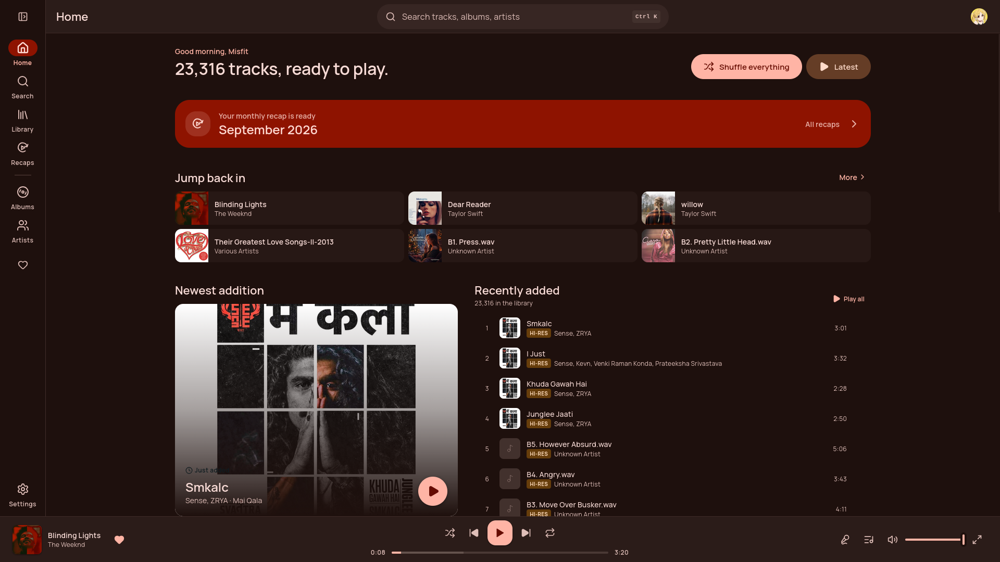
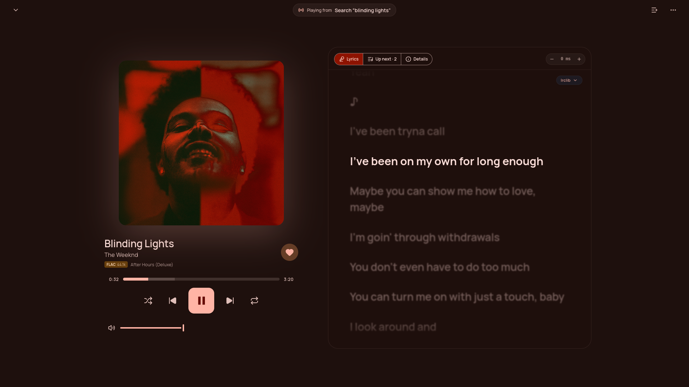
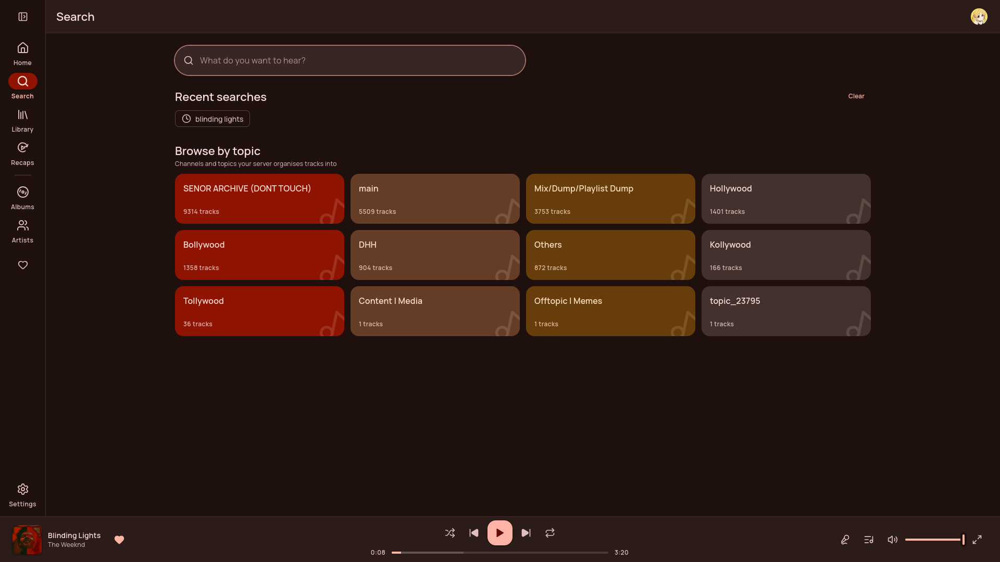
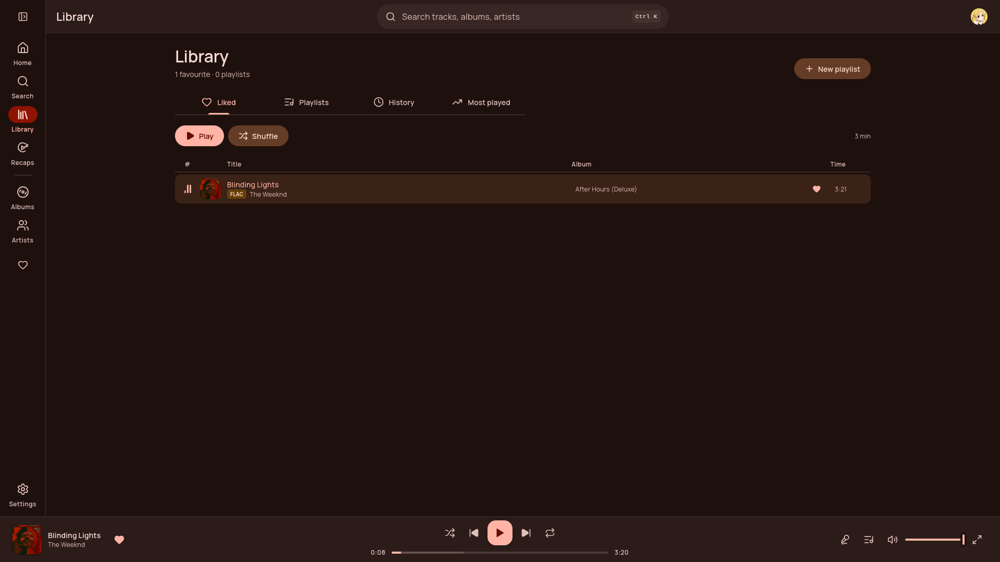
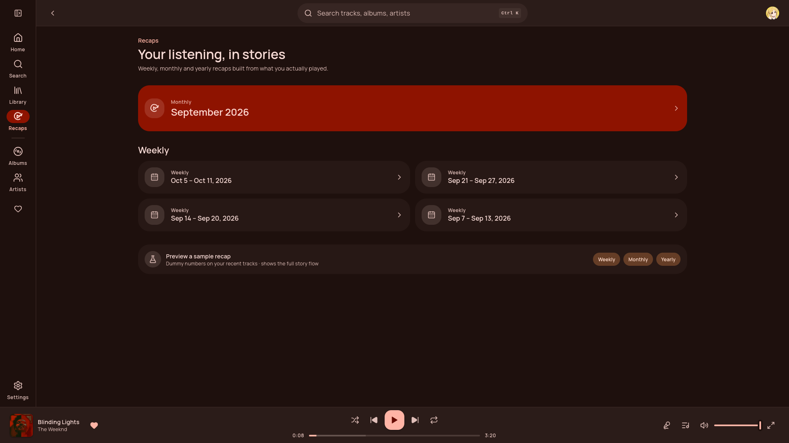
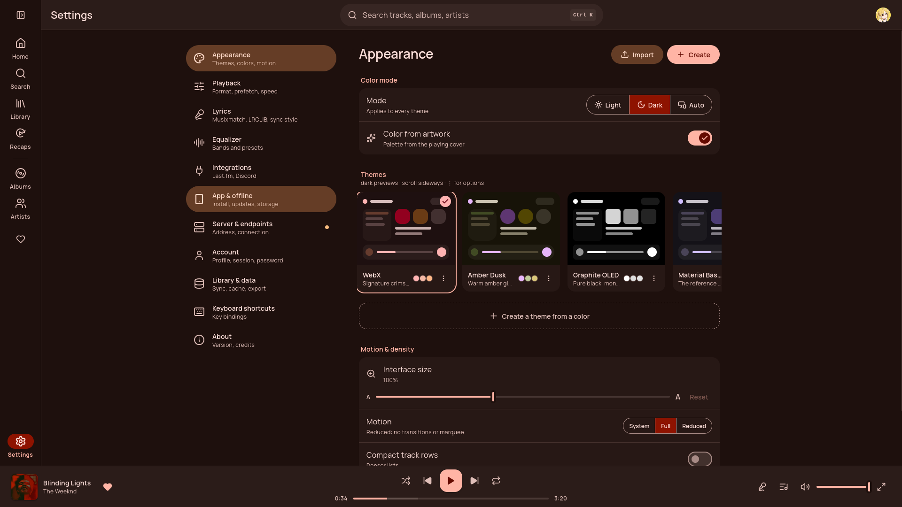

<div align="center">


# WebX

A web player for your StreamX music server.

[StreamX](https://github.com/StreamXProject/StreamX) · [StreamXBot](https://github.com/StreamXProject/StreamXBot) · [StreamX Project](https://github.com/StreamXProject)



</div>

## Features

- **Your library** — search, albums, artists, topics, liked songs, playlists, history and most played
- **Now playing** — synced lyrics from LRCLIB, KuGou, Apple Music, YouTube Music and more, up next and track details
- **Recaps** — weekly, monthly and yearly stories from what you played
- **Themes** — built-in themes, colours from the playing artwork, or your own
- **Playback** — gapless queue, equaliser, audio quality and hi-res badges
- **Integrations** — Last.fm and Discord
- **Installable** — works as an app on desktop and phone

## Screenshots

<table>
  <tr>
    <td></td>
    <td></td>
  </tr>
  <tr>
    <td align="center"><sub>Now playing</sub></td>
    <td align="center"><sub>Search</sub></td>
  </tr>
  <tr>
    <td></td>
    <td></td>
  </tr>
  <tr>
    <td align="center"><sub>Library</sub></td>
    <td align="center"><sub>Recaps</sub></td>
  </tr>
  <tr>
    <td colspan="2"></td>
  </tr>
  <tr>
    <td colspan="2" align="center"><sub>Themes and settings</sub></td>
  </tr>
</table>

## Run it

Needs Node.js 20.19 or newer.

```bash
npm install
npm run dev
```

Set your server's address in **Settings → Server & endpoints**. When WebX is served from the same address as your server, it connects on its own.

## Build

```bash
npm run build
```

The site is written to `dist/`. Host it anywhere that serves static files, or behind your StreamXBot server.

| Command | |
|---|---|
| `npm run dev` | Development server |
| `npm run host` | Development server on your network |
| `npm run build` | Production build |
| `npm run preview` | Preview the build |
| `npm test` | Tests |
| `npm run lint` | Lint |
| `npm run typecheck` | Type check |

## License

[GPL-3.0](LICENSE)
